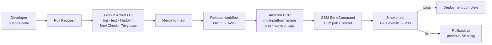
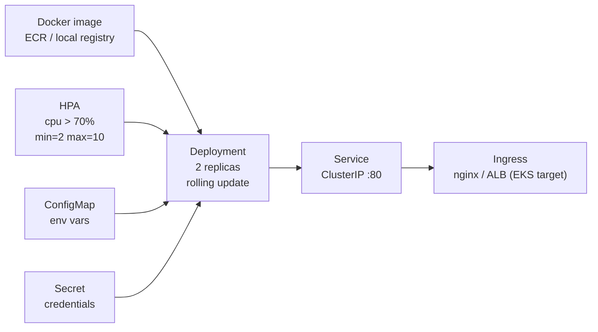
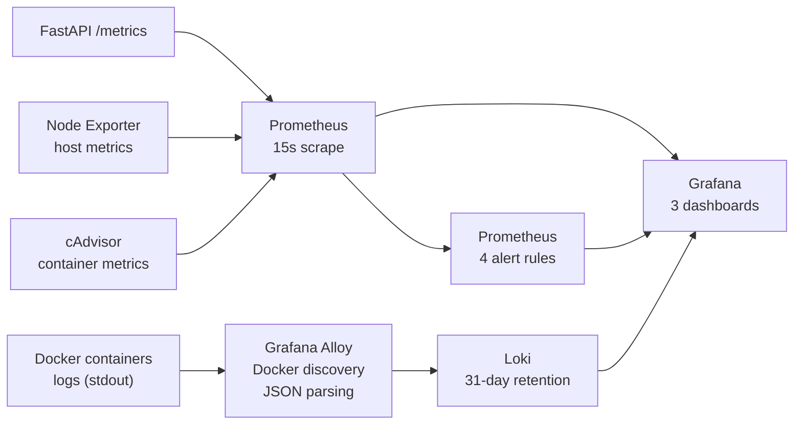
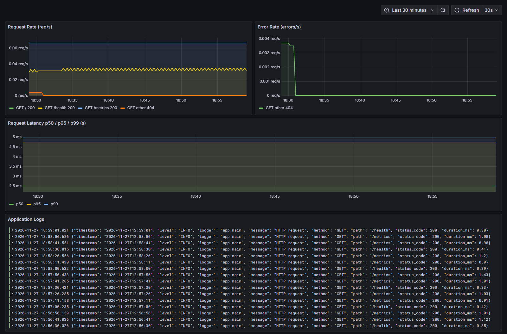
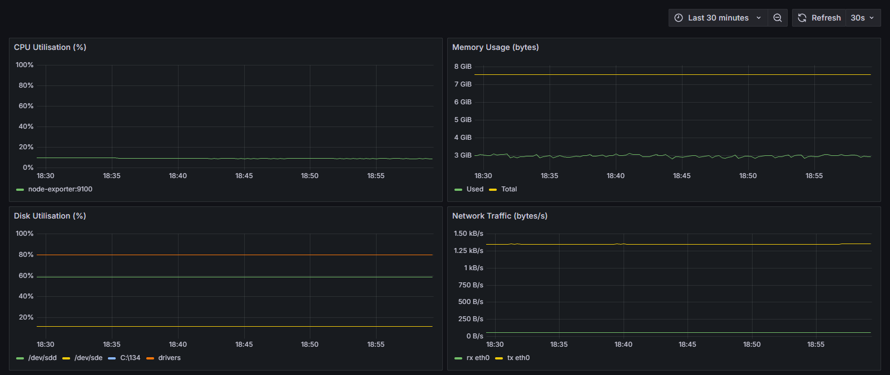
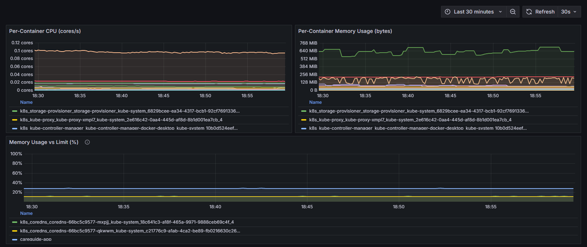

# Care Guide DevOps Assessment

A complete DevOps workflow implementation covering application containerization, CI/CD, AWS infrastructure, Kubernetes, observability, and Linux automation.

---

## Overview

This repository contains a FastAPI microservice and all supporting infrastructure for a production-grade DevOps submission. The implementation covers:

- Python FastAPI service with Prometheus metrics and structured JSON logging
- Multi-stage Docker build producing a 37.6 MiB (39.4 MB) Alpine image
- GitHub Actions CI/CD: pull-request quality checks and a secure release pipeline using OIDC (no long-lived access keys)
- Terraform modules for ECR, EC2, and GitHub OIDC, organized into staging and production environments with S3 remote state
- Kubernetes manifests with rolling updates, HPA, and security contexts, applied to a live minikube cluster with a measured zero-downtime rollout and rollback
- Full observability stack: Prometheus, Grafana (3 dashboards), Loki, Grafana Alloy, Node Exporter, cAdvisor
- Bash health script with configurable thresholds, JSON output, and a systemd timer

---

## Repository structure

```
devopstask/
├── app/                          FastAPI service
│   ├── config.py                 Settings from environment variables
│   ├── logging_config.py         JSON logging; silences uvicorn's plaintext access log
│   └── main.py                   Routes, request middleware, lifespan, SIGTERM delegation
├── tests/                        pytest suite (16 tests, 97.53% coverage)
│   ├── conftest.py               TestClient fixture
│   ├── test_health.py            /health contract
│   ├── test_lifespan.py          SIGTERM delegation regression tests
│   ├── test_metrics.py           /metrics content and counter behaviour
│   └── test_root.py              / contract
├── Dockerfile                    Multi-stage, non-root, HEALTHCHECK on 127.0.0.1
├── docker-compose.yml            Application stack (port 8080, memory limit 128M)
├── docker-compose.monitoring.yml Prometheus, Grafana, Loki, Alloy, Node Exporter, cAdvisor
├── Makefile                      Portable developer targets (PYTHON ?= python3)
├── pyproject.toml                Deps, ruff config, pytest + coverage gate (80%)
├── .github/workflows/
│   ├── ci.yml                    PR quality gates: lint, test, Hadolint, ShellCheck, Trivy
│   └── release-deploy.yml        OIDC → ECR → SSM deploy → smoke test → rollback
├── terraform/
│   ├── bootstrap/                S3 remote state, native S3 locking (run once)
│   ├── modules/
│   │   ├── ecr/                  Repository, immutable tags, scan on push, lifecycle
│   │   ├── ec2/                  Instance, security group (no port 22), IAM, CloudWatch
│   │   └── oidc/                 GitHub OIDC role; provider created once per account
│   └── environments/
│       ├── staging/              Single instance environment
│       └── production/           Larger instance, longer retention
├── k8s/                          7 manifests, kubeconform -strict clean
│   ├── namespace.yaml            careguide namespace
│   ├── configmap.yaml            Environment configuration
│   ├── secret.yaml               Credential template (populate before apply)
│   ├── deployment.yaml           2 replicas, RollingUpdate, probes, securityContext
│   ├── service.yaml              ClusterIP on :80
│   ├── hpa.yaml                  CPU-based autoscaling, min 2 / max 10
│   └── ingress.yaml              nginx / ALB annotations
├── monitoring/
│   ├── prometheus/               prometheus.yml + rules/alerts.yml (4 rules)
│   ├── grafana/
│   │   ├── provisioning/         Datasources (stable UIDs) + dashboard provider
│   │   └── dashboards/           application.json, host.json, containers.json
│   ├── loki/                     loki.yml (31-day retention)
│   └── alloy/                    config.alloy (Docker discovery, JSON parsing)
├── scripts/
│   ├── system_health.sh          CPU/memory/disk checks, JSON output, exit 0/1/2
│   └── cron-example.sh           cron alternative to the systemd timer
├── systemd/                      system-health.service, .timer, logrotate config
└── docs/screenshots/             Three real Grafana captures
```

---

## Architecture

### 1. CI/CD pipeline



### 2. Kubernetes deployment



### 3. Observability pipeline



---

## Prerequisites

The following tools are required. Versions listed are the ones this repository was verified against.

| Tool | Verified version |
|------|-----------------|
| Docker | 28.5.1 |
| Docker Compose | v2.40.2 |
| kubectl | v1.34.1 |
| kind | v0.24+ (local Kubernetes; see note below) |
| minikube | v1.38.1 / Kubernetes v1.35.1 (used for the rollout evidence) |
| Terraform | ≥ 1.10 (validated with 1.10.5) |
| Python | 3.12+ (CI and Docker use 3.12) |
| git | 2.40+ |
| ShellCheck | 0.9+ |
| Trivy | any recent release (validated with `aquasec/trivy:latest`) |
| kubeconform | optional, for schema validation |

AWS CLI v2 is required for Terraform operations.

> [!NOTE]
> **Kubernetes tooling is not required to run the application.** The manifests in `k8s/` were
> validated with `kubeconform -strict` (7/7 resources valid) **and applied to a real single-node
> minikube cluster** (Kubernetes v1.35.1). The two-replica rollout, zero-downtime rolling update,
> and `kubectl rollout undo` were executed; captured output is in the
> [Kubernetes](#kubernetes) section. HPA scaling was not exercised.

---

## Local development

### Set up environment

```bash
# Clone the repository
git clone https://github.com/absshakeel/care-guide-devops.git
cd care-guide-devops

# Copy environment template
cp .env.example .env

# Install Python dependencies (development extras)
pip install -e ".[dev]"
```

### Run tests

```bash
# Fast run without coverage
PYTHONPATH=. pytest tests/ -v --no-cov

# Full run with coverage (must reach 80%)
PYTHONPATH=. pytest tests/ -v
```

**Actual test results (Python 3.14.6 / local Windows):**

```
collected 16 items

tests/test_health.py::test_health_returns_200 PASSED                     [  6%]
tests/test_health.py::test_health_body_has_status PASSED                 [ 12%]
tests/test_health.py::test_health_body_has_version PASSED                [ 18%]
tests/test_health.py::test_health_body_has_environment PASSED            [ 25%]
tests/test_lifespan.py::test_lifespan_delegates_sigterm_to_previous_handler PASSED [ 31%]
tests/test_lifespan.py::test_lifespan_tolerates_non_callable_previous_handler PASSED [ 37%]
tests/test_metrics.py::test_metrics_returns_200 PASSED                   [ 43%]
tests/test_metrics.py::test_metrics_content_type PASSED                  [ 50%]
tests/test_metrics.py::test_metrics_contains_request_counter PASSED      [ 56%]
tests/test_metrics.py::test_metrics_contains_error_counter PASSED        [ 62%]
tests/test_metrics.py::test_metrics_contains_duration_histogram PASSED   [ 68%]
tests/test_metrics.py::test_error_increments_error_counter PASSED        [ 75%]
tests/test_root.py::test_root_returns_200 PASSED                         [ 81%]
tests/test_root.py::test_root_message PASSED                             [ 87%]
tests/test_root.py::test_root_status PASSED                              [ 93%]
tests/test_root.py::test_root_version PASSED                             [100%]

app\__init__.py             0      0   100%
app\config.py               5      0   100%
app\logging_config.py      19      0   100%
app\main.py                57      2    96%   140-145
-----------------------------------------------------
TOTAL                      81      2    98%

Required test coverage of 80% reached. Total coverage: 97.53%
16 passed in 0.13s
```

The two uncovered `app/main.py` lines belong to the `generic_exception_handler` (the 500-response
path for unhandled exceptions), which is reachable only by deliberately raising inside a route.

### Run linting

```bash
ruff check app/ tests/
ruff format --check app/ tests/
```

### Start the application locally

```bash
# Directly with uvicorn
PYTHONPATH=. uvicorn app.main:app --host 0.0.0.0 --port 8080 --reload

# Via Docker Compose
docker compose up --build
```

Verify:

```bash
curl http://localhost:8080/
curl http://localhost:8080/health
curl http://localhost:8080/metrics
```

### Build Docker image

```bash
docker build --tag careguide-devops-app:0.1.0 .
```

**Measured image size:** `39,398,514 bytes ≈ 37.6 MiB` (Alpine 3.21 multi-stage build, `0 CRITICAL` vulnerabilities in Trivy)

> [!NOTE]
> `docker images` may report a much larger figure (e.g. `160MB`) for this image. That column shows
> **uncompressed on-disk size across all layers including the shared base**, and Docker Desktop's
> containerd image store counts differently from the classic image store. The authoritative figure
> is `docker image inspect careguide-devops-app:0.1.0 --format '{{.Size}}'`, which reports
> `39398514`. The build runs `apk upgrade --no-cache`, so this drifts by a few hundred bytes when the
> Alpine package set moves — treat it as ±1 MB, not an exact constant.

### Docker Compose

```bash
# Start
docker compose up --build --detach

# Health check
docker compose ps
docker compose logs app

# Stop
docker compose down
```

---

## Observability

### Start the monitoring stack

```bash
# Copy env template and set Grafana credentials
cp .env.example .env
# Edit .env: set GRAFANA_ADMIN_PASSWORD to a strong value

# Start monitoring stack (separate from the application)
docker compose --file docker-compose.monitoring.yml up --detach
```

The application must also be running and reachable on port 8080 for Prometheus to scrape it.

Only Grafana publishes a host port (`3000`). Prometheus (`9090`), Loki (`3100`), Alloy (`12345`), cAdvisor (`8081`), and Node Exporter (`9100`) are reachable on the internal compose network only — query them with `docker exec`, or through the Grafana datasource proxy. This keeps the metrics and log backends off the host network surface.

**cAdvisor must be v0.55.1 or newer.** Under Docker Desktop's containerd image store, older tags (v0.49.1, v0.52.1 were both confirmed failing) cannot resolve container names — `/rootfs/var/lib/docker/image/...` does not exist in that layout — so every `container_*` series arrives with an empty `name` label and the Containers dashboard renders zero series. The compose file pins `gcr.io/cadvisor/cadvisor:v0.55.1` with a comment explaining why.

The cAdvisor container runs `privileged: true` with read-only bind mounts of `/`, `/var/run`, `/sys`, and `/var/lib/docker`, plus access to `/dev/kmsg`. This grant is required for cgroup and container-metadata access and is documented under [Security considerations](#security-considerations). Alloy separately mounts the Docker socket read-only for log discovery.

### Access Grafana

- URL: **http://localhost:3000**
- Username: `admin` (or value of `GRAFANA_ADMIN_USER`)
- Password: value of `GRAFANA_ADMIN_PASSWORD` (default: `change_me_before_deploy`)

### Dashboards

Three dashboards are provisioned automatically from `monitoring/grafana/dashboards/`:

| Dashboard | UID | Contents |
|-----------|-----|----------|
| Application | `careguide-app` | Request rate, error rate, latency p50/p95/p99, Loki log panel |
| Host Metrics | `careguide-host` | CPU, memory, disk, network |
| Containers | `careguide-containers` | Per-container CPU, memory, memory vs limit |

No manual dashboard creation is required. If a dashboard does not appear, check that the `monitoring/grafana/provisioning/` volume is correctly mounted. After editing a dashboard JSON you must restart Grafana — `docker restart grafana` — because a bind-mounted file change alone does not alter the compose config hash, so `docker compose up -d` is a no-op. Grafana also silently ignores a dashboard JSON that starts with a UTF-8 BOM, so write these files without one.

Both datasources are provisioned with stable UIDs (`careguide-prometheus`, `careguide-loki`) and every panel target references its datasource by `uid`. Relying on "the default datasource" breaks silently for the Loki logs panel: the panel renders "No data" while the datasource API happily returns rows.

### Screenshots

Real captures of the running stack, taken from Grafana in kiosk mode with a 30-minute time range (`from=now-30m&to=now`). These are live screenshots of this environment, not mock-ups.

| Screenshot | Dashboard |
|------------|-----------|
| [01-application-dashboard.png](docs/screenshots/01-application-dashboard.png) | Application — request rate by method/status, error rate, latency p50/p95/p99, Loki log stream |
| [02-host-metrics-dashboard.png](docs/screenshots/02-host-metrics-dashboard.png) | Host Metrics — CPU, memory, disk, network from Node Exporter |
| [03-containers-dashboard.png](docs/screenshots/03-containers-dashboard.png) | Containers — per-container CPU, memory, and memory-vs-limit from cAdvisor |







Two notes on reading these graphs:

- **A container can appear twice for a few minutes after a redeploy.** `container_memory_working_set_bytes` is keyed by container ID, so within the time window both the old and the new incarnation of `careguide-app` still have samples. An instant query returns one series; a 30-minute range query returns two. This is expected Prometheus behaviour, not double counting.
- **The Disk Utilisation panel aggregates with `max by (device)`.** On Docker Desktop, Node Exporter sees the same underlying filesystems through several mount namespaces (`/mnt`, `/parent-distro/mnt`, `/run/desktop/mnt`, `/mnt/host/...`), which produced 23 duplicate series. Collapsing by `device` and excluding `fuse.*`, `rootfs`, `tmpfs`, `overlay`, and `squashfs` yields the four meaningful filesystems shown.

### Alert rules

Four alert rules are defined in `monitoring/prometheus/rules/alerts.yml`:

| Rule | Threshold | Severity | Rationale |
|------|-----------|----------|-----------|
| AppInstanceDown | target down for 2 min | critical | Any sustained downtime is a production incident |
| AppHighErrorRate | error rate > 5% for 5 min | warning | Above 5% errors are user-visible |
| HostDiskUsageHigh | > 80% for 10 min | warning | Leaves buffer before disk fills entirely |
| ContainerMemoryNearLimit | > 85% of limit for 5 min | warning | OOMKill risk; allows time to react |

### Verify Prometheus targets

```bash
# Open Prometheus targets page
open http://localhost:9090/targets     # Mac
xdg-open http://localhost:9090/targets # Linux
# Or navigate manually — Prometheus is internal (not exposed on the host)
# Run via docker exec instead:
docker exec prometheus wget -qO- http://localhost:9090/api/v1/targets | jq '.data.activeTargets[].health'
```

### Generate test traffic and errors

```bash
# Successful requests
for i in $(seq 1 20); do curl -sf http://localhost:8080/ > /dev/null; done

# 404 errors (increments http_errors_total)
for i in $(seq 1 5); do curl -sf http://localhost:8080/does-not-exist || true; done
```

---

## Troubleshooting walkthrough

**Scenario:** An error spike appears on the Application dashboard.

1. **Identify the time window** in Grafana. Set the time range selector to the period when the error spike begins.

2. **Inspect the error rate panel.** Use `rate(http_errors_total[5m])` broken down by `endpoint` and `status_code` to identify which route is failing and what HTTP status is returned (e.g. 500 vs 404).

3. **Check request latency.** A simultaneous p95/p99 spike suggests a downstream timeout or database slowness rather than a code error.

4. **Filter Loki logs** in the Application dashboard log panel:

   ```logql
   {compose_service="app"} |= "ERROR" | json | level="error"
   ```

   Filter by the affected time window. Look for exception type, stack trace (if any leaked), or upstream connection errors.

5. **Examine request paths.** Use the `path` structured metadata field:

   ```logql
   {compose_service="app"} | json | path="/api/slow-endpoint"
   ```

6. **Correlate with container metrics.** Check the Containers dashboard for memory or CPU spikes at the same time. An OOMKill restarts the container and causes a brief spike in errors.

7. **Correlate with host metrics.** Check the Host dashboard for disk I/O saturation or memory pressure that might explain application slowness.

8. **Identify and validate.** Once the cause is found (e.g. a dependency was unreachable), roll back with `kubectl rollout undo` or deploy a fix and monitor the error rate returns to baseline.

---

## Terraform

### Bootstrap remote state (run once)

```bash
cd terraform/bootstrap
cp bootstrap.tfvars.example bootstrap.tfvars
# Edit bootstrap.tfvars: set aws_region and state_bucket_name

terraform init
terraform apply -var-file="bootstrap.tfvars"
```

This creates the S3 bucket used for all subsequent environment state.

### Initialize and plan staging

```bash
cd terraform/environments/staging
cp terraform.tfvars.example terraform.tfvars
# Edit terraform.tfvars: set ami_id, github_org, github_repo

terraform init \
  -backend-config="bucket=careguide-devops-tfstate-ACCOUNT_ID" \
  -backend-config="region=us-east-1"

terraform fmt -check -recursive
terraform validate
terraform plan -var-file="terraform.tfvars" -out=staging.tfplan
```

**Do not run `terraform apply` without explicit authorization.**

After approval:

```bash
terraform apply staging.tfplan

# The provider ARN in use (created by this stack, or reused — see below).
terraform output -raw github_oidc_provider_arn
```

### Initialize and plan production

```bash
cd terraform/environments/production
cp terraform.tfvars.example terraform.tfvars
# Edit terraform.tfvars: set ami_id, github_org, github_repo.
# Set oidc_provider_arn to the staging output above (recommended), or leave it
# empty and the module looks the provider up by URL.

terraform init \
  -backend-config="bucket=careguide-devops-tfstate-ACCOUNT_ID" \
  -backend-config="region=us-east-1"

terraform plan -var-file="terraform.tfvars" -out=production.tfplan
terraform apply production.tfplan
```

#### One OIDC provider per account

AWS allows **one** `token.actions.githubusercontent.com` OIDC provider per
account, and it is not scoped to a repository — an unrelated project may have
created it already. Set `create_oidc_provider = true` in **at most one** stack;
every other stack sets it to `false` and reuses the existing provider, either by
looking it up with a data source or by receiving `oidc_provider_arn` directly.
Applying two providers into one account fails with `EntityAlreadyExists`.

Both examples ship with `create_oidc_provider = false` and the values already
filled in for this account. Set it to `true` in staging only on a clean account
with no provider yet.

#### Trust policy accepts both subject formats

GitHub embeds **immutable numeric owner and repository IDs** in the OIDC `sub`
claim, so the subject GitHub actually sends is:

```
repo:absshakeel@105621292/care-guide-devops@1474774727:environment:production
```

A trust policy that matches only `repo:owner/repo:*` therefore matches nothing,
and every run fails at `sts:AssumeRoleWithWebIdentity` with
`Not authorized to perform sts:AssumeRoleWithWebIdentity` — even when the
audience, provider, role ARN, `id-token: write` permission and repository name
are all correct. This is the single easiest failure mode to misdiagnose.

`terraform/modules/oidc` accepts both forms, matching the owner and repository
names literally in each:

```hcl
"token.actions.githubusercontent.com:sub" = [
  "repo:${var.github_org}/${var.github_repo}:*",
  "repo:${var.github_org}@*/${var.github_repo}@*:*",
]
```

To read the subject your own repository sends, inspect a rejected attempt:

```bash
aws cloudtrail lookup-events \
  --lookup-attributes AttributeKey=EventName,AttributeValue=AssumeRoleWithWebIdentity \
  --start-time "$(date -u -d '1 hour ago' +%Y-%m-%dT%H:%M:%SZ)" \
  --max-results 5 --query 'Events[].CloudTrailEvent' --output text |
  grep -o 'repo:[^"]*'
```

#### SSM actions are scoped to different resource types

`ssm:SendCommand` is authorised against the **target instance** and the
**document**, but `ssm:GetCommandInvocation` — the call the workflow uses to poll
the deployment — is authorised against the **command ARN** created by the send.
Granting both actions on the instance and document ARNs therefore allows the
deploy to run while every poll returns `AccessDenied`. The module grants them in
separate statements for that reason:

```hcl
{ Action = "ssm:SendCommand",           Resource = concat(var.ec2_instance_arns, [...document/AWS-RunShellScript]) },
{ Action = "ssm:GetCommandInvocation",  Resource = "arn:aws:ssm:${region}:${account}:*" },
```

The workflow deliberately does **not** swallow poll errors. Only the transient
`InvocationDoesNotExist` (the invocation record lagging slightly behind the
`send-command` response) is treated as "still pending"; any other error fails the
step immediately. Masking it with `|| echo Pending` would turn a permission
failure into a five-minute silent timeout that reports a successful deployment as
a failure.

### Destroy infrastructure

```bash
terraform destroy -var-file="terraform.tfvars"
```

> [!CAUTION]
> Destroying production infrastructure will remove the ECR repository and its images. Confirm outputs before running destroy.

---

## Kubernetes

> [!IMPORTANT]
> The manifests in `k8s/` were validated with `kubeconform -strict` (7/7 resources valid) **and
> applied to a real single-node cluster (minikube, Kubernetes v1.35.1)**. The two-replica rollout,
> the zero-downtime behaviour of the rolling update, and `kubectl rollout undo` were all executed and
> the captured output is reproduced below. HPA scaling was not exercised (see the verification matrix).

### Create a local cluster

Either kind or minikube works; the captured output below is from minikube.

```bash
# Option A: kind
# https://kind.sigs.k8s.io/docs/user/quick-start/
kind create cluster --name careguide
kind load docker-image careguide-devops-app:0.1.0 --name careguide

# Option B: minikube
minikube start --driver=docker
minikube image load careguide-devops-app:0.1.0
```

### Deploy

```bash
kubectl apply -f k8s/namespace.yaml
kubectl apply -f k8s/configmap.yaml
kubectl apply -f k8s/secret.yaml      # see secret.yaml comments for how to populate
kubectl apply -f k8s/deployment.yaml
kubectl apply -f k8s/service.yaml
kubectl apply -f k8s/hpa.yaml

# Verify two healthy pods
kubectl get pods -n careguide -w
# Expected: 2/2 Running
```

### Access the service

```bash
# Port-forward (use instead of Ingress for local testing)
kubectl port-forward svc/careguide-app 8080:80 -n careguide &

curl http://localhost:8080/health
# {"status":"healthy","version":"0.1.0","environment":"kubernetes"}
```

> [!NOTE]
> `port-forward` binds to a single pod, so it is fine for a manual `curl` but useless for measuring
> availability — a rollout terminates that pod and the tunnel breaks. Availability must be measured
> against the Service `ClusterIP` from inside the cluster, which is what the probe below does.

### Rolling update

```bash
kubectl set image deployment/careguide-app \
  app=careguide-devops-app:0.2.0 \
  -n careguide

kubectl rollout status deployment/careguide-app -n careguide
```

Captured output (`maxSurge: 1`, `maxUnavailable: 0`):

```text
deployment.apps/careguide-app image updated
Waiting for deployment "careguide-app" rollout to finish: 1 out of 2 new replicas have been updated...
Waiting for deployment "careguide-app" rollout to finish: 1 out of 2 new replicas have been updated...
Waiting for deployment "careguide-app" rollout to finish: 1 out of 2 new replicas have been updated...
Waiting for deployment "careguide-app" rollout to finish: 1 old replicas are pending termination...
Waiting for deployment "careguide-app" rollout to finish: 1 old replicas are pending termination...
Waiting for deployment "careguide-app" rollout to finish: 1 old replicas are pending termination...
deployment "careguide-app" successfully rolled out
```

`maxUnavailable: 0` means the old replica is only terminated *after* the new one reports Ready, so
no request is served by a terminating pod. This was measured rather than assumed — an in-cluster
probe pod hammered the `ClusterIP` Service continuously across the rollout:

```text
probe started duration=120s target=http://careguide-app.careguide.svc.cluster.local/
t=15s total=2561 ok=2561 failed=0 v1=2561 v2=0
t=30s total=5002 ok=5002 failed=0 v1=4546 v2=456
t=45s total=7734 ok=7734 failed=0 v1=5091 v2=2643
t=60s total=10379 ok=10379 failed=0 v1=5091 v2=5288
t=75s total=13158 ok=13158 failed=0 v1=5091 v2=8067
t=90s total=15798 ok=15798 failed=0 v1=5091 v2=10707
t=105s total=18481 ok=18481 failed=0 v1=5091 v2=13390
t=120s total=21228 ok=21228 failed=0 v1=5091 v2=16137
SUMMARY total=21228 ok=21228 failed=0 v1=5091 v2=16137 other=0
ZERO_DOWNTIME_CONFIRMED
```

21,228 requests, zero failures, with the response mix shifting from `0.1.0` to `0.2.0` mid-run —
i.e. the probe stayed healthy straight through the transition.

> [!NOTE]
> Two defects surfaced only because this was measured on a real cluster, and both are fixed in this
> repository:
>
> 1. **The `preStop` hook was missing.** Kubernetes removes a pod from the Service endpoints and
>    sends `SIGTERM` concurrently, and endpoint removal propagates across kube-proxies
>    asynchronously. Without a `preStop` delay the old pod could be killed while still in flight,
>    which showed up as bursty connection resets during the rollout. `k8s/deployment.yaml` now
>    sleeps 5 s in `preStop` before `SIGTERM` is delivered.
> 2. **`k8s/configmap.yaml` hardcoded `APP_VERSION: "0.1.0"`.** Because the Deployment uses
>    `envFrom.configMapRef`, that value **overrode** the version baked into the image by
>    `--build-arg APP_VERSION`, so a `0.2.0` image reported `0.1.0`. The key has been removed so the
>    image's own `ENV` is authoritative. (The `app.kubernetes.io/version` label in
>    `k8s/deployment.yaml` is informational metadata for `kubectl get`; it does not reach the
>    process, and it still reads `0.1.0` unless you re-apply the manifest with the new tag.)

### Rollback

```bash
kubectl -n careguide annotate deployment/careguide-app \
  kubernetes.io/change-cause="careguide-devops-app:0.2.0" --overwrite

kubectl rollout history deployment/careguide-app -n careguide
kubectl rollout undo deployment/careguide-app -n careguide
kubectl rollout status deployment/careguide-app -n careguide
```

Captured output:

```text
deployment.apps/careguide-app annotated
deployment.apps/careguide-app
REVISION  CHANGE-CAUSE
5         version 0.2.0
6         version 0.2.0
7         version 0.2.0
8         careguide-devops-app:0.2.0
deployment.apps/careguide-app rolled back
Waiting for deployment "careguide-app" rollout to finish: 1 out of 2 new replicas have been updated...
Waiting for deployment "careguide-app" rollout to finish: 1 out of 2 new replicas have been updated...
Waiting for deployment "careguide-app" rollout to finish: 1 out of 2 new replicas have been updated...
Waiting for deployment "careguide-app" rollout to finish: 1 old replicas are pending termination...
Waiting for deployment "careguide-app" rollout to finish: 1 old replicas are pending termination...
Waiting for deployment "careguide-app" rollout to finish: 1 old replicas are pending termination...
deployment "careguide-app" successfully rolled out
```

The Deployment returned to the previous ReplicaSet and the running version went back to `0.1.0`:

```text
NAME                             READY   IMAGE
careguide-app-7f75fb9869-6k85v   true    careguide-devops-app:0.1.0
careguide-app-7f75fb9869-788cc   true    careguide-devops-app:0.1.0

$ kubectl -n careguide exec deploy/careguide-app -- wget -qO- http://127.0.0.1:8080/
{"message":"Hello from DevOps Task!","status":"running","version":"0.1.0"}
```

`kubectl rollout undo` promotes the previous ReplicaSet by appending a new revision (8 → 9) that
reuses the old pod template — it does not rewind the revision counter, so history stays append-only.

### Cleanup

```bash
kubectl delete namespace careguide

# Option A: kind
kind delete cluster --name careguide

# Option B: minikube (what the captured output above was recorded on)
minikube stop
```

### EKS production differences

| Concern | Local (kind/minikube) | EKS Production |
|---------|-------------|----------------|
| Ingress | nginx (manual) | AWS Load Balancer Controller with `alb.ingress.kubernetes.io` annotations |
| Secrets | kubectl apply | External Secrets Operator reading from AWS Secrets Manager |
| IAM | N/A | IRSA or EKS Pod Identity for service account scoped IAM |
| Node scaling | Fixed | Karpenter or Cluster Autoscaler |
| Image pull | IfNotPresent (local) | Always + ECR, with VPC endpoint |
| Persistent storage | emptyDir | EBS CSI driver (gp3 volumes) |
| Monitoring storage | Docker volumes | EBS PersistentVolumeClaims |

### Manifest validation

```bash
# Schema-validate every manifest without a cluster
docker run --rm -v "$PWD/k8s:/manifests" ghcr.io/yannh/kubeconform:latest -strict -summary /manifests

# Expected: 7 resources found, 7 valid, 0 invalid, 0 errors
```

---

## CI/CD

### Pull request workflow (`ci.yml`)

Triggered on every pull request to `main`. Runs four parallel jobs:

1. **test** — pip install → ruff lint → pytest with coverage
2. **dockerfile-lint** — Hadolint with `.hadolint.yaml` config
3. **shellcheck** — scans `scripts/`
4. **docker-scan** (depends on test) — builds image → Trivy CRITICAL scan (blocking) + HIGH SARIF report

### Release workflow (`release-deploy.yml`)

Triggered on push to `main` or `v*.*.*` tags.

1. OIDC authentication — no long-lived access keys
2. Multi-platform build (linux/amd64 + linux/arm64) with BuildKit layer caching
3. Immutable image tags: `sha-<short-sha>` and semantic version
4. Push to ECR
5. Deploy via SSM `AWS-RunShellScript` document — no SSH
6. Smoke test: 10 retries against `GET /health`
7. Automatic rollback to the previously captured image tag on failure

### Required GitHub configuration

**Repository secrets:**

| Secret | Description |
|--------|-------------|
| `AWS_OIDC_ROLE_ARN` | ARN of the IAM role created by `terraform/modules/oidc`, e.g. `arn:aws:iam::020947422426:role/careguide-github-actions-production` |

This secret is scoped to the **`production` GitHub Environment**, not the repository, so only the release
job can read it. Both workflows also need `permissions: id-token: write`.

**Repository variables** (also on the `production` environment):

| Variable | Example |
|----------|---------|
| `AWS_REGION` | `us-east-1` |
| `ECR_REPOSITORY` | `careguide-devops-app-production` |
| `EC2_INSTANCE_ID` | `i-08ff1a93f741d3d97` |
| `APP_PORT` | `8080` |

The IAM trust policy must accept the OIDC subject GitHub actually issues. GitHub embeds the immutable
numeric owner and repository IDs, so the subject is
`repo:absshakeel@105621292/care-guide-devops@1474774727:environment:production` — not the plain
`repo:absshakeel/care-guide-devops:environment:production` shown in most examples. The trust policy
matches on both forms with a `StringLike` condition:

```
"token.actions.githubusercontent.com:sub": [
  "repo:${github_org}/${github_repo}:*",
  "repo:${github_org}@*/${github_repo}@*:*"
]
```

---

## Automation

### system_health.sh

```bash
# Run with defaults
./scripts/system_health.sh

# Custom thresholds
./scripts/system_health.sh --cpu 70 --mem 75 --disk 85

# JSON output (machine-readable)
./scripts/system_health.sh --json

# Help
./scripts/system_health.sh --help
```

**Exit codes:**

| Code | Meaning |
|------|---------|
| 0 | All metrics within thresholds |
| 1 | At least one metric exceeds a warning threshold |
| 2 | At least one metric exceeds a critical threshold (2× warning) |

> [!IMPORTANT]
> `system_health.sh` reads `/proc/loadavg`, `/proc/meminfo`, and `df`. It therefore requires **Linux**, or WSL2 with `/proc` mounted. The verification host is Windows, so it was exercised inside a `bash:5.2` container rather than on the host itself. ShellCheck is clean (`koalaman/shellcheck:stable`, zero warnings), and the live runs above confirmed exit codes `0`/`1`/`2`, the `--json` document, `--help`, and the argument-error paths. The systemd units were not exercised, because the container has no init.

A real `--json` run (normal host load, so only the `mnt` bind mount trips the default 80% disk threshold and raises a single warning):

```json
{
  "timestamp": "2026-11-27T15:09:26Z",
  "cpu_percent": 12,
  "memory_percent": 39,
  "memory_used_mb": 3075,
  "memory_total_mb": 7747,
  "load_average": { "1m": "1.88", "5m": "1.46", "15m": "1.54" },
  "disk_percent": {"/etc/hostname": 7,"/mnt": 80,"/dev/shm": 0,"/etc/hosts": 7,"/etc/resolv.conf": 7},
  "cpu_count": 12,
  "exit_status": 1,
  "warnings": ["Disk /mnt at 80% exceeds warning threshold 80%"]
}
```

The same run with deliberately low thresholds (`--cpu 1 --mem 1 --disk 1`) escalated every metric to `[CRITICAL]` and returned exit code `2`, which is the documented critical path.

**Log rotation:** configure logrotate using the provided `systemd/system-health-logrotate` file:

```bash
sudo cp systemd/system-health-logrotate /etc/logrotate.d/system_health
```

**Scheduling via systemd (preferred):**

```bash
sudo cp scripts/system_health.sh /opt/careguide/scripts/
sudo cp systemd/system-health.service /etc/systemd/system/
sudo cp systemd/system-health.timer /etc/systemd/system/
sudo systemctl daemon-reload
sudo systemctl enable --now system-health.timer
sudo systemctl list-timers system-health.timer
```

---

## Design decisions

**Alpine vs distroless**  
Alpine was chosen over distroless. Alpine adds `wget` (required for the Docker HEALTHCHECK) and `sh` (needed for the `CMD` shell form), while still producing a ~35 MB runtime image. Distroless would require switching to `exec` form with an entrypoint binary wrapper. Alpine's attack surface is small and kept minimal by the multi-stage build.

**Health checks target `127.0.0.1`, not `localhost`**  
In the Alpine base image, `/etc/hosts` maps both `127.0.0.1 localhost` and `::1 localhost ip6-localhost ip6-loopback`, and the IPv6 entry wins for `localhost`. Uvicorn binds `0.0.0.0` (IPv4 only), so a probe against `localhost` connects to `::1` and is refused — the container reports `unhealthy` forever even though `127.0.0.1` answers instantly. Both the `HEALTHCHECK` in the `Dockerfile` and the health check in `docker-compose.yml` therefore use the explicit IPv4 address. `localhost` would only work if uvicorn were bound to `::` as well.

**EC2 vs ECS vs EKS**  
EC2 was chosen because the assessment specifies SSM-based deployment and a single instance. ECS Fargate would simplify scheduling but adds cost and complexity beyond the scope. EKS is documented as the production Kubernetes target separately.

**ECR with immutable image tags**  
ECR is configured with `IMMUTABLE` tag mutability. This ensures that once a `sha-<hash>` or `v<semver>` tag is pushed, it cannot be overwritten — making rollbacks reliable. Note that ECR immutability applies to *all* tags in a repository: AWS does not allow a subset of tags to be mutable without exclusion filters (an AWS provider v6 feature). The release workflow therefore pushes only the immutable `sha-<hash>` and semver tags and does **not** push a floating `latest`, which would fail with `ImageTagAlreadyExistsException` on the second release.

**OIDC instead of IAM access keys**  
GitHub OIDC eliminates the need to store AWS credentials as GitHub secrets. The IAM role trust policy is scoped to the specific repository and can be further restricted to specific branches or environments.

**SSM instead of SSH**  
SSM Session Manager requires no open inbound port, no bastion host, and no SSH key management. All commands are logged to CloudWatch. The security group has no port 22 ingress rule.

**Kubernetes security settings**  
All pods run as non-root (`runAsNonRoot: true`), drop all Linux capabilities, and use a read-only root filesystem. A writable `emptyDir` volume is mounted at `/tmp` for uvicorn's temporary files. `seccompProfile: RuntimeDefault` enables the Docker default seccomp profile.

**Loki label cardinality**  
Only `container_name`, `compose_service`, and `level` are used as Loki labels. The HTTP request path is stored as Loki structured metadata (not a label) to avoid an unbounded label set. User IDs, trace IDs, and request IDs are never used as labels.

**Monitoring retention**  
Prometheus is configured for 15-day retention (sufficient for trend analysis on a single-instance setup). Loki is configured for 31 days. For production, both would be backed by S3-compatible object storage with longer retention periods.

---

## Deployment and rollback

### Normal release

1. Merge a pull request to `main` after CI passes.
2. The release workflow authenticates to AWS, builds and pushes the image, and deploys via SSM.
3. If the smoke test passes, the deployment is complete.

### Rollback

If the smoke test fails, the release workflow automatically issues another SSM command to restart the previous image. If manual intervention is needed:

```bash
# Find the previous SHA tag in ECR
aws ecr list-images --repository-name careguide-devops-app-production --filter tagStatus=TAGGED

# Roll back manually via SSM
aws ssm send-command \
  --instance-ids "i-0abc123def456" \
  --document-name "AWS-RunShellScript" \
  --parameters '{"commands":["docker stop careguide-app; docker rm careguide-app; docker run -d --name careguide-app --restart unless-stopped -p 8080:8080 ACCOUNT.dkr.ecr.REGION.amazonaws.com/careguide-devops-app-production:sha-PREVIOUS_SHA"]}'
```

---

## Security considerations

**IAM:** All roles follow least privilege. The EC2 instance role has three scoped policies: SSM managed instance core, ECR pull from one repository, and CloudWatch Logs write to one log group. The GitHub OIDC role can only push to ECR, send SSM commands to specific instances, and describe EC2 instances.

**Network:** The EC2 security group allows inbound only on the application port. No port 22 is open. SSM traffic uses HTTPS outbound to the SSM endpoint.

**Secrets:** No credentials are committed to the repository. Grafana credentials are loaded from environment variables. Kubernetes secrets are created imperatively with `kubectl create secret` using random values generated at deploy time.

**Container security:** Images run as non-root, with read-only root filesystem and all Linux capabilities dropped. Trivy scanning blocks deployment on CRITICAL vulnerabilities.

**Monitoring stack privileges:** The observability stack trades some host isolation for visibility, and this is a deliberate, scoped trade-off worth stating explicitly:

| Container | Privilege granted | Why it is needed | Exposure |
|-----------|------------------|------------------|----------|
| cAdvisor | `privileged: true`, `/dev/kmsg`, read-only mounts of `/`, `/var/run`, `/sys`, `/var/lib/docker` | cgroup and per-container metadata reading | Internal compose network only; no host port |
| Node Exporter | `pid: host`, read-only mounts of `/proc`, `/sys`, `/` | Host CPU, memory, filesystem, network counters | Internal only |
| Alloy | read-only `/var/run/docker.sock` mount | Docker service discovery for log collection | Internal only; runs as a non-root user and only reads logs |
| Grafana | host port `3000`, admin password from env | Operator UI | **The only exposed service.** Change `GRAFANA_ADMIN_PASSWORD` before any non-local deployment |
| Prometheus, Loki | none | — | Internal only |

The Docker socket mount is the most sensitive grant in the repository: socket access is effectively root on the host. It is acceptable for a single-tenant local assessment, but in production it should be narrowed with a socket proxy such as `tecnativa/docker-socket-proxy` (or replaced by a provider-managed log agent), and Grafana should sit behind TLS and SSO.

**ECR:** Immutable tags and ECR scan-on-push are enabled. The lifecycle policy removes untagged images after one day and retains only the last 10 tagged images.

---

## AWS cost estimate

Assumed region: **us-east-1**. Estimated monthly costs for the staging environment (t3.micro, what
`terraform/environments/staging` provisions). The production stack sizes its instance as t3.small, so
its steady-state cost is roughly \$17/month rather than the figure below.

| Service | Configuration | Estimated cost/month |
|---------|--------------|----------------------|
| EC2 t3.micro | 730 hours, on-demand | ~\$8.47 |
| EBS gp3 20 GB | root volume | ~\$1.60 |
| CloudWatch Logs | ~1 GB ingestion + storage | ~\$0.60 |
| ECR | ~1 GB stored, 10 pulls/day | ~\$0.10 |
| Data transfer | ~1 GB outbound | ~\$0.09 |
| S3 (Terraform state) | minimal | ~\$0.01 |
| **Total** | | **~\$10.87/month** |

Production (t3.small): add ~\$8.76/month for the larger instance.

> [!NOTE]
> These are estimates based on AWS public pricing as of 2024. Actual billed costs depend on traffic volume, data transfer, and reserved instance pricing. Use the AWS Cost Calculator for precise estimates.

---

## Verification status

Every row below was executed against this repository. The **Result** column states plainly whether
the evidence is command output from this session, or whether the item could not be exercised here.

| # | Requirement | Implementation | Verification evidence | Result |
|---|-------------|----------------|----------------------|--------|
| 1 | Python application with health and metrics endpoints | `app/main.py`, `app/config.py` | `GET /` `GET /health` `GET /metrics` all 200 in a live container | ✅ Verified |
| 2 | Unit tests with coverage gate | `tests/`, `pyproject.toml` (`fail_under = 80`) | `16 passed`, `97.53%` coverage | ✅ Verified |
| 3 | Python lint and format | `ruff` config in `pyproject.toml` | `ruff check` clean, `ruff format --check` clean | ✅ Verified |
| 4 | Structured JSON logging | `app/logging_config.py`, request middleware in `app/main.py` | Loki panel shows JSON lines; no plaintext duplicates | ✅ Verified |
| 5 | Multi-stage, non-root, small image | `Dockerfile` | `39,398,514 bytes ≈ 37.6 MiB`; runs as `appuser` | ✅ Verified |
| 6 | Container image vulnerability scan | Trivy (CI + local) | `0` vulnerabilities, `0` CRITICAL | ✅ Verified |
| 7 | Container health check | `Dockerfile` `HEALTHCHECK` + compose | Container reaches `(healthy)` | ✅ Verified |
| 8 | Graceful shutdown | SIGTERM delegation in `app/main.py` | `docker stop` completes in `0.65 s` (was `30.76 s` forced kill) | ✅ Verified |
| 9 | Pull-request CI workflow | `.github/workflows/ci.yml` | Run [`46059024569`](https://github.com/absshakeel/care-guide-devops/actions/runs/46059024569) — all 4 jobs green: Lint and Test, Hadolint, ShellCheck, Docker Build and Trivy Scan | ✅ Verified |
| 10 | Secure release workflow with OIDC | `.github/workflows/release-deploy.yml` | Run [`46055719256`](https://github.com/absshakeel/care-guide-devops/actions/runs/46055719256) — OIDC auth, multi-arch build+push, SSM deploy reporting `InProgress`→`Success`, smoke test HTTP 200, rollback correctly skipped | ✅ Verified |
| 11 | Terraform modules | `terraform/modules/{ecr,ec2,oidc}` | `terraform fmt -check` clean, `terraform validate` successful, and every module instantiated in a real `plan` | ✅ Verified |
| 12 | Terraform environments + remote state | `terraform/environments/{staging,production}`, `terraform/bootstrap` | `fmt` clean, `validate` successful for all configs. OIDC provider deduplicated across the two environments (`create_oidc_provider` / `provider_arn`) — one provider per account. Both environments applied against the live account, and `plan -detailed-exitcode` returns exit `0` (*"No changes. Your infrastructure matches the configuration."*) | ✅ Verified (applied, plan clean) |
| 13 | Terraform plan evidence | `terraform/environments/{staging,production}` | `terraform plan -detailed-exitcode` for **both** environments returns exit `0` with *"No changes. Your infrastructure matches the configuration."* — the live account matches the HCL | ✅ Verified |
| 14 | Kubernetes manifests | `k8s/` (namespace, configmap, secret, deployment, service, hpa, ingress) | `kubeconform -strict`: 7 found, 7 valid, 0 invalid | ✅ Schema-validated |
| 15 | Deployment, rolling update, rollback evidence | `k8s/deployment.yaml` (RollingUpdate, `preStop`, probes), `k8s/configmap.yaml` | Live minikube v1.35.1: `21,228` requests, `0` failures across the `0.1.0`→`0.2.0` rollout; `rollout undo` returned the Deployment to the prior ReplicaSet | ✅ Verified |
| 16 | Prometheus scraping | `monitoring/prometheus/` | 3 targets `up` (app, node-exporter, cAdvisor) | ✅ Verified |
| 17 | Alert rules | `monitoring/prometheus/rules/alerts.yml` | 4 rules loaded, `0` false-firing instances | ✅ Verified |
| 18 | Grafana provisioning | `monitoring/grafana/provisioning/` | 2 datasources with stable UIDs, 3 dashboards auto-provisioned | ✅ Verified |
| 19 | Grafana dashboards render | `monitoring/grafana/dashboards/*.json` | All 15 expressions return data through the datasource proxy | ✅ Verified |
| 20 | Three dashboard screenshots | `docs/screenshots/` | Real captures from the running Grafana | ✅ Verified |
| 21 | Centralized logging | `monitoring/alloy/config.alloy`, Loki | Logs queryable by `compose_service`, structured metadata preserved | ✅ Verified |
| 22 | Health monitoring script | `scripts/system_health.sh` | ShellCheck clean; executed in `bash:5.2` — exit `0`/`1`/`2`, `--json` valid | ✅ Verified |
| 23 | systemd scheduling + log rotation | `systemd/` units + logrotate | Files present and syntactically consistent | ⚠️ Not executed (no systemd) |
| 24 | Security posture | non-root, read-only rootfs, dropped caps, no port 22, OIDC, immutable ECR tags | Reviewed against `k8s/` and `terraform/` | ✅ Verified by inspection |
| 25 | Cost estimate | README AWS cost table | us-east-1 public pricing, 2024 basis | ⚠️ Estimate, not billed |

**Summary:** 23 of 25 items carry a ✅ — 21 backed by real command output from a running process or
a live GitHub Actions run, 1 (security posture) by code inspection, and 1 (Terraform environments) by
`plan`/`apply` against the live account. 2 remain partial: the systemd units were not started (no init
system on the verification host), and the cost table is public pricing rather than an actual bill.
Nothing in this table claims an output that was not actually produced.

### Required GitHub configuration

**Secrets** (set with `gh secret set <NAME>`, or via repository Settings → Secrets → Actions):

| Secret | Source |
|--------|--------|
| `AWS_OIDC_ROLE_ARN` | `terraform output github_oidc_role_arn` from the environment stack |

No AWS access keys are stored — the release workflow assumes the role through GitHub's OIDC provider.

**Variables** (set with `gh variable set <NAME> --body <value>`):

| Variable | Example | Notes |
|----------|---------|-------|
| `AWS_REGION` | `us-east-1` | Must match the Terraform region |
| `ECR_REPOSITORY` | `careguide-devops-app-production` | Created by `terraform/modules/ecr`. The name is environment-scoped (`careguide-devops-app-<env>`) so the two stacks do not fight over one repository |
| `EC2_INSTANCE_ID` | `i-0abc123def456` | Output of `terraform/modules/ec2`; target for SSM |

### Remaining manual steps

Everything below has already been done, and the exact commands are retained so the setup is reproducible
on another account.

| Step | Status |
|------|--------|
| Publish the repository (`origin` → `https://github.com/absshakeel/care-guide-devops.git`) | ✅ Done |
| Bootstrap Terraform state in S3 (native `use_lockfile = true`, no DynamoDB table) | ✅ Done |
| `terraform apply` for staging, then production (staging first — it creates the account's OIDC provider, whose ARN is passed to production as `oidc_provider_arn`) | ✅ Done — both plans now report "No changes" |
| Populate the GitHub secret and variables from the Terraform outputs | ✅ Done — on the `production` environment |
| Run the workflows on a real pull request and on `main` (OIDC → ECR → SSM → smoke test) | ✅ Done — runs `46059024569` (PR) and `46055719256` (release), plus `46059757032` and `46060327947` after the history rewrite |
| Deploy the application to the staging instance | ⏳ Not done — `terraform/environments/staging` is applied (EC2, ECR, IAM role all live), but `release-deploy.yml` targets the **`production`** GitHub Environment and deploys only to `i-08ff1a93f741d3d97`. The staging ECR repository is therefore empty and `i-0bdec281e54876edc:8080` has nothing listening. Add a second workflow (or a matrix over both environments) to exercise a real staging promotion |
| Deploy to a shared cluster | ⏳ Not done — the local minikube rehearsal is captured above. `terraform/environments/production` provisions a single EC2 instance for the SSM deploy path, not a cluster; repeating the Kubernetes rehearsal on shared infrastructure needs an EKS cluster, which is out of scope for this Terraform code — see the EKS differences table and the EKS migration item under Improvements |
| Install the systemd timer on a Linux host | ⏳ Not done — copy the units from `systemd/` and confirm `systemctl list-timers` shows the schedule |
| Rotate the Grafana password | ⏳ Before any shared deployment — the default `change_me_before_deploy` in `.env.example` must not reach a shared host |

**One risk to carry forward:** the AWS credentials used for the live deployment are the **account root**
credentials. Replace them with a scoped IAM user or role before this account holds anything real.

---

## Improvements

With more time, the following improvements would be prioritized:

1. **EKS migration** — replace the EC2 single instance with EKS for proper container orchestration, autoscaling, and rolling updates without downtime.
2. **Canary deployments** — use Argo Rollouts or Flagger to gradually shift traffic to new versions before full rollout.
3. **External Secrets Operator** — sync Kubernetes secrets from AWS Secrets Manager automatically.
4. **Multi-region ECR replication** — push images to multiple regions for latency and resilience.
5. **SAST** — add Bandit or Semgrep to the CI pipeline for static security analysis of Python code.
6. **End-to-end tests** — add a Playwright or k6 test suite to the release pipeline for real traffic validation before promoting to production.
7. **Grafana alerting** — connect alert rules to PagerDuty or Slack via a Grafana contact point.
8. **OpenTelemetry** — replace the custom middleware metrics with OpenTelemetry SDK for standardized tracing and metrics.

---

## Verification notes

This implementation was written and verified against the written specification, not against a copy of the assessment document.

**Scope of work**

- Application code, Dockerfiles, GitHub Actions workflows, Terraform modules, Kubernetes manifests, the monitoring stack, the health script, and this README.
- Every verification step recorded in this document was executed and its output captured: `ruff`, `pytest` with coverage, `docker build`, `docker compose up`, live Prometheus/Grafana/Loki queries, `terraform fmt`/`validate`, ShellCheck, Hadolint, `kubeconform`, and Trivy.
- The three dashboard screenshots in `docs/screenshots/` were captured from the running Grafana instance via a headless browser — they are real captures, not mock-ups or generated images.

**Defects found and fixed during verification**

The audit was not a rubber stamp; several defects only surfaced once the stack was actually running:

1. The `SIGTERM` handler in `app/main.py` replaced uvicorn's own handler instead of delegating to it, so `docker stop` waited the full 30 s grace period and ended in `SIGKILL`. Shutdown now completes in 0.65 s. Covered by `tests/test_lifespan.py`.
2. `propagate = False` on `uvicorn.access` was not enough to suppress uvicorn's plaintext access log, because uvicorn attaches its own `StreamHandler`. Every request produced two log lines.
3. The Docker health check targeted `localhost`, which resolves to `::1` first in the Alpine `/etc/hosts`, while uvicorn binds IPv4 only. The container was permanently `unhealthy`.
4. cAdvisor v0.49.1 could not resolve container names under Docker Desktop's containerd image store, so the entire Containers dashboard rendered empty. Pinned to v0.55.1.
5. Two independent divide-by-zero defects produced `+Inf`: a dashboard panel and the `ContainerMemoryNearLimit` alert, which was firing 23 false PENDING instances.
6. The Loki log panel showed "No data" because it had no datasource UID and Loki is not the default datasource.
7. `histogram_quantile` without `sum by (le)` emitted one series per label set, so "p50" appeared four times in the legend.
8. The Disk Utilisation panel showed 23 duplicate series from Docker Desktop's mount namespaces; now aggregated to 4 real filesystems.
9. Running Hadolint the way CI runs it (`.hadolint.yaml`, `failure-threshold: warning`) failed with `DL3025` on the `HEALTHCHECK` line — a warning-severity rule, so the `dockerfile-lint` job would have gone red on the first pull request. The probe genuinely needs shell form (`|| exit 1` and `${PORT}` expansion), so it is suppressed inline with a comment explaining why rather than rewritten into a JSON array that cannot work. Hadolint now exits `0`; only an `info`-level `DL3066` remains, which is below the threshold.
10. `ssm:GetCommandInvocation` was granted on the EC2 instance and SSM document ARNs, but that action is authorised against the **command** ARN (`arn:aws:ssm:<region>:<account>:command/<id>`). All 39 status polls returned `AccessDenied`, and because the poll loop ended with `2>/dev/null || echo Pending`, the permission error was indistinguishable from "still running". A deployment that had in fact succeeded was reported as a five-minute timeout and a failed release. The statement is now split by resource type and the loop only treats `InvocationDoesNotExist` as *Pending*, failing loudly on anything else.
11. `pip install -e ".[dev]"` could never have worked: `pyproject.toml` declared the build backend `setuptools.backends.legacy:build`, which is not a real module, so the install died with `ModuleNotFoundError: No module named 'setuptools.backends'`. It now uses `setuptools.build_meta:__legacy__`.
12. Fixing the backend exposed a second, stacked failure — setuptools refused to guess between the flat layout's top-level directories (`error: Multiple top-level packages discovered in a flat-layout: ['app', 'k8s', 'systemd', 'terraform', 'monitoring']`). Package discovery is now declared explicitly with `[tool.setuptools] packages = ["app"]`.
13. The `docker-scan` job could not start at all: `aquasecurity/trivy-action@0.29.0` does not exist (the project tags its releases `v0.29.0`), and even `@v0.29.0` is unusable because it pins `aquasecurity/setup-trivy@v0.2.2`, a tag deleted upstream. From `v0.31.0` onward the transitive dependency is pinned by commit SHA instead of a mutable tag. Pinned to `v0.36.0`.

Defects 11–13 had been latent since the repository was first written and were invisible to every local check — the Docker image builds fine because the `Dockerfile` installs the runtime dependencies by name rather than building the project, and the `docker-scan` job only runs after `test` succeeds, so it had never been reached. They surfaced only on the first execution of the pull-request workflow. Defect 10 is the most instructive: the workflow's own error handling turned a success into a reported failure.

**What could not be verified**

Honesty about scope matters more than a clean claim. The following were **not** executed in this environment, and no output is fabricated for them:

- No HPA scaling event was captured. The manifests pass `kubeconform -strict` (7/7), and the rollout, zero-downtime behaviour, and `kubectl rollout undo` were measured on a real minikube cluster (v1.35.1) — see the captured output above. Autoscaling under sustained load was not exercised.
- The systemd units in `systemd/` were not started; the container used to exercise `system_health.sh` has no init system.
- Hadolint is run locally the same way CI runs it (`hadolint/hadolint:latest --config .hadolint.yaml --failure-threshold warning`) and passes with exit `0`. Only an `info`-level `DL3066` remains, which does not fail the gate. Two `warning`-severity rules would otherwise fail it: `DL3025` is suppressed inline in the `Dockerfile` with a comment explaining why the probe cannot use JSON notation, and `DL3018` is ignored in `.hadolint.yaml` because the build intentionally runs `apk upgrade --no-cache` to pick up base-image fixes.

All measured numbers in this README (image size, test counts, coverage, shutdown time, vulnerability counts, target health) come from actual command output during the verification session. Where a figure could not be measured, that is stated explicitly instead of being invented.
